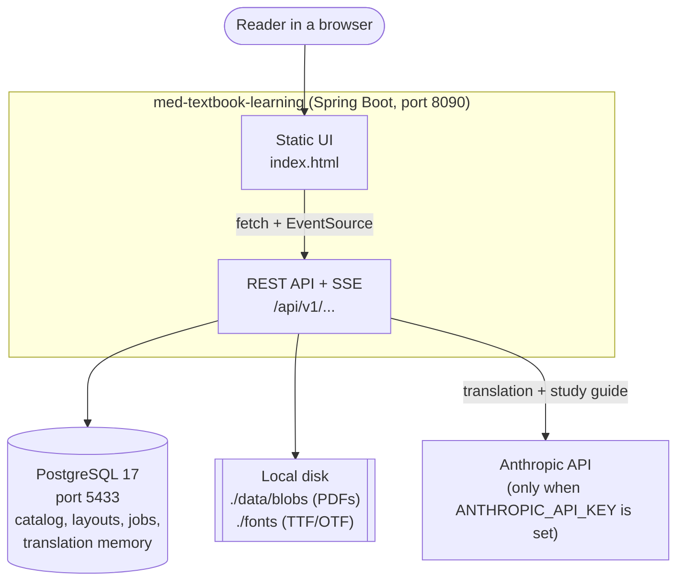
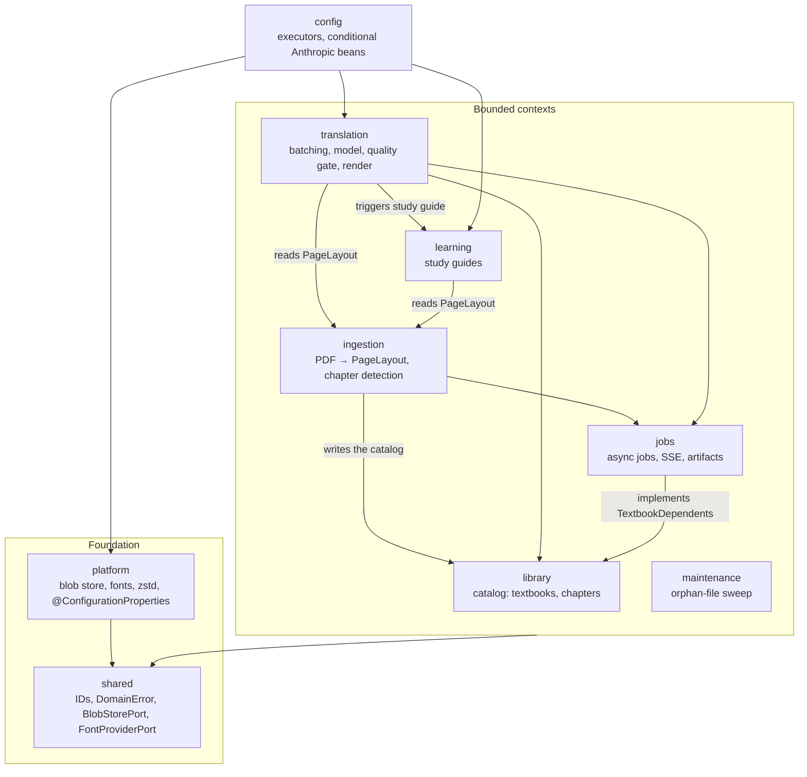
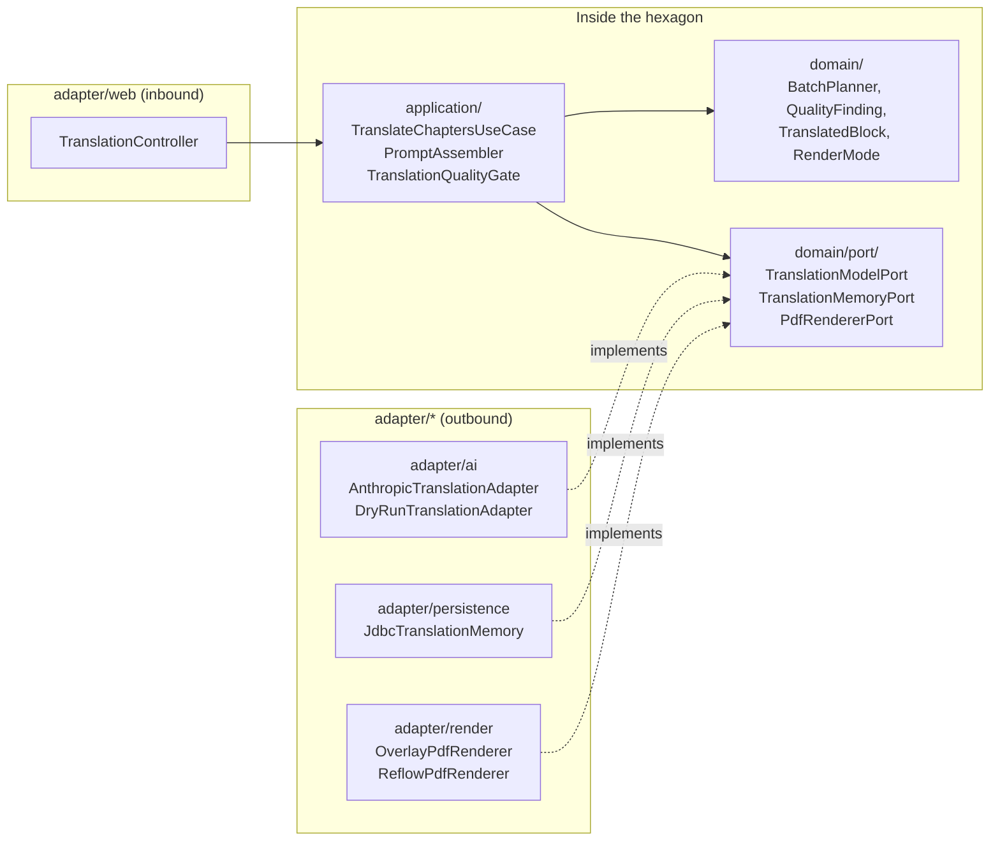
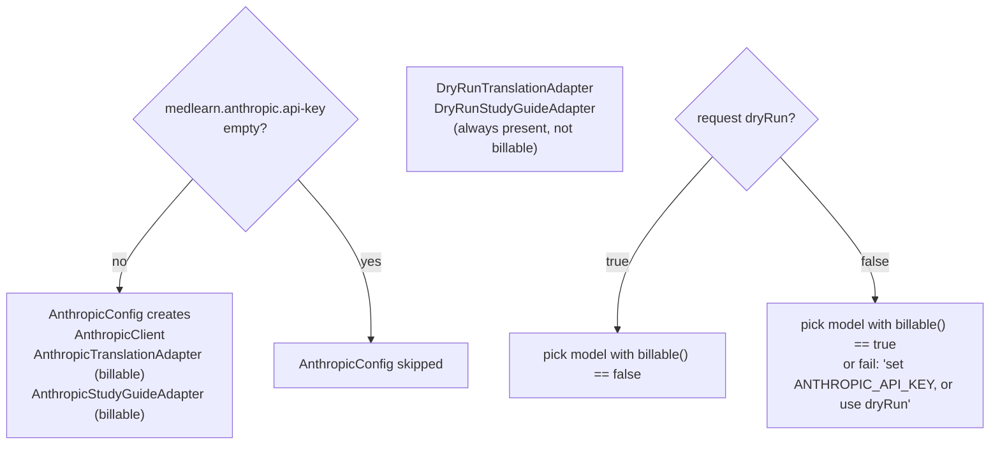
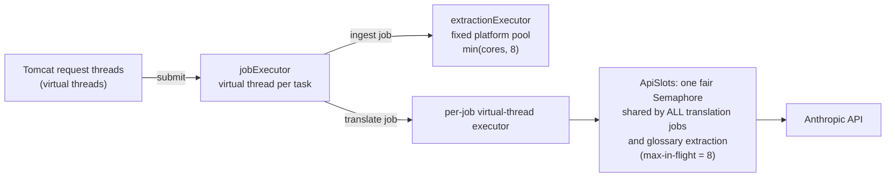

# 1. Architecture (HLD)

## 1.1 System context

A single-user, local-first web application. It runs as one Spring Boot process with one Postgres database. Large files live on the local disk, and the Anthropic API is the only external service.

| Concern | Choice |
|---|---|
| Runtime | Java 25, Spring Boot 4 (Web MVC, JDBC, Flyway, Actuator) |
| Database | PostgreSQL 17 with plain JDBC (no JPA). The schema lives in `src/main/resources/db/migration` |
| PDF reading and overlay | Apache PDFBox 3 |
| Reflow and study-guide PDFs | OpenHTMLtoPDF (HTML/CSS → PDF) |
| Layout compression | zstd-jni |
| LLM | `anthropic-java` SDK with structured output and prompt caching |
| Boundary enforcement | ArchUnit (`HexagonalArchitectureTest`) |

## 1.2 Bounded contexts

The code is organised by context first and by layer second. Each top-level package under `com.medlearn` is one context.

Every arrow is one-way, and `HexagonalArchitectureTest` fails the build if a cycle appears. Notable rules:

- `library` never imports `ingestion`. That is why uploading lives in `IngestionController` and not `TextbookController`.
- `learning` knows nothing about `translation`. Translation calls into learning, never the reverse.
- `maintenance` imports only `shared`. It learns which files are in use through `BlobReferencesPort`, which `library` and `jobs` implement on their repositories.
- `library` never imports `jobs`. Deleting a textbook clears its jobs and artifact files through the `TextbookDependents` port, which `library` owns and `jobs` implements.
- No context imports `config`. It only wires things together.

## 1.3 Hexagonal layers inside a context

Every context has the same shape. `translation` is shown here as the example.

| Layer | May depend on | Must not depend on |
|---|---|---|
| `domain/` | the JDK, `shared` | Spring, PDFBox, Jackson 2/3, Anthropic, zstd, OpenHTMLtoPDF, `jakarta.*`, `javax.sql`, `platform` |
| `application/` | `domain`, ports, Spring stereotypes | any `adapter` package |
| `adapter/` | everything above, plus infrastructure libraries | other contexts' adapters |

## 1.4 Live and dry-run wiring

Both use cases, `TranslateChaptersUseCase` and `GenerateStudyGuideUseCase`, take a `List` of model ports and choose one per request. The app always starts. A live request without a key fails its job with a clear message.

## 1.5 Threading model

| Executor | Kind | Runs | Why |
|---|---|---|---|
| Tomcat | virtual | HTTP requests | `spring.threads.virtual.enabled=true` |
| `jobExecutor` | virtual, unbounded | each job body | jobs mostly wait on I/O |
| `extractionExecutor` | platform, bounded | page extraction chunks | CPU and memory heavy. Each worker holds its own `PDDocument` |
| per-translation executor | virtual, gated by the process-wide `ApiSlots` semaphore | batch and term-extraction API calls | the API rate limit belongs to the account, so concurrent jobs share one limit |

## 1.6 Cross-cutting decisions

| Decision | Where | Reason |
|---|---|---|
| Content-addressed blobs | `FilesystemBlobStore` | a re-upload is a no-op, and a failed upload never leaves a half-written file under a valid name |
| Layout stored as zstd JSON in `bytea` | `LayoutCodec`, `page_layout` | about 1 KB per page, and nothing queries inside it |
| Two Jackson majors | `pom.xml` | Jackson 3 for web payloads (Boot 4), Jackson 2 only for SDK DTOs and `LayoutCodec` |
| Sealed state and outcome types | `JobState`, `UploadOutcome`, `Outcome` | an exhaustive `switch` turns a new state into a compile error at every call site |
| Errors as values | `DomainError` | use cases return `Rejected(error)`, and controllers map it to `422` |
