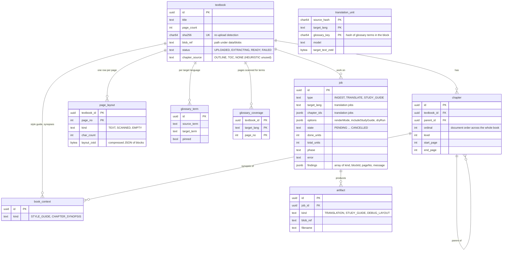
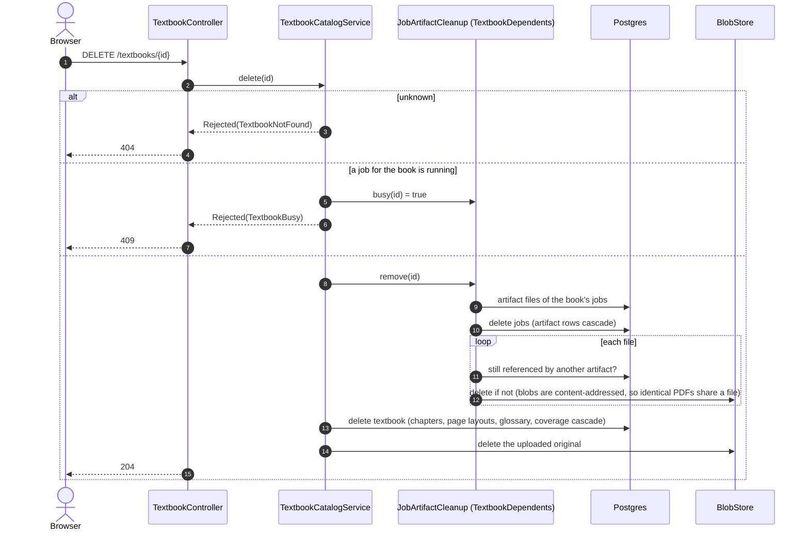
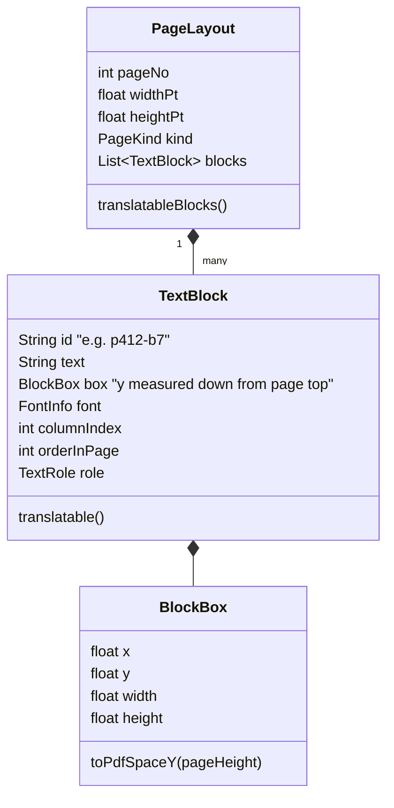
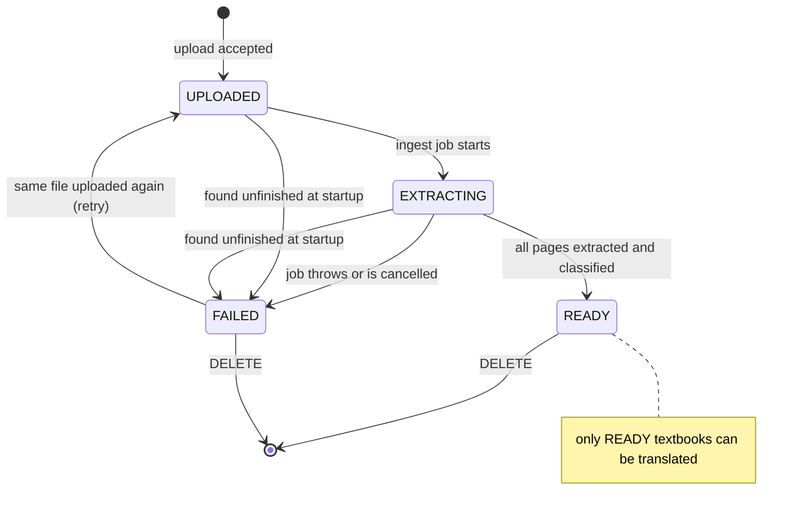
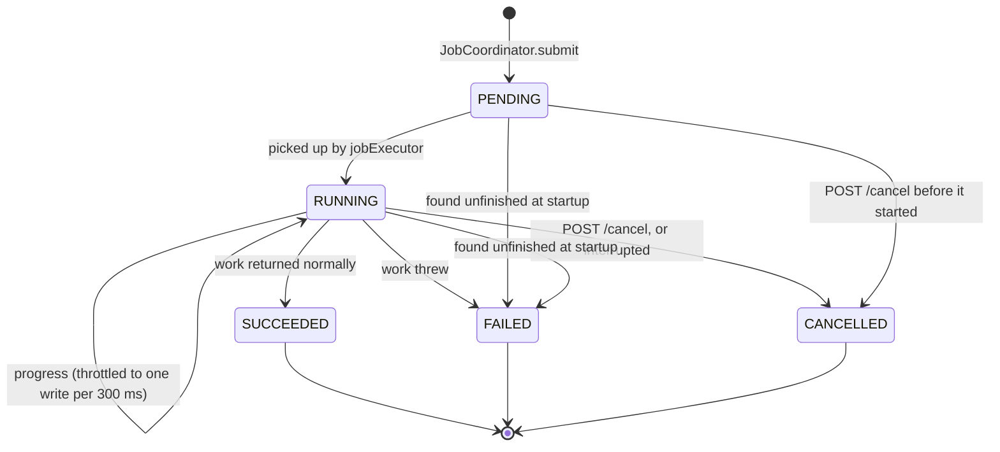

# 2. Data model

The schema is `src/main/resources/db/migration/V1__initial_schema.sql`, applied by Flyway at startup. New changes go in a new `V<n>__*.sql` file.

## 2.1 Tables



| Table | Written by | Read by | Notes |
|---|---|---|---|
| `textbook` | `IngestTextbookUseCase` | catalog, translation | `sha256` is unique, so the hash is the de-duplication key |
| `chapter` | ingestion (`ChapterRepository.replaceAll`) | catalog, translation | a flat list with `parent_id`. The tree is rebuilt in `TextbookCatalogService.chapterTree` |
| `page_layout` | ingestion, written in batches of `page-write-batch-size` | translation, learning, layout debug | written twice per page when furniture roles change |
| `translation_unit` | `JdbcTranslationMemory` | translation, live runs only | **not** linked to a textbook. The key is the content hash plus the glossary key, so identical paragraphs with the same glossary terms share one entry across books. Dry runs never read or write it |
| `glossary_term` | `GlossaryService` (extraction adds, reader edits pin) | translation, study guide, `GlossaryController` | unique per book and language on `lower(source_term)`. See [Glossary flow](11-flow-glossary.md) |
| `glossary_coverage` | `GlossaryService` | `GlossaryService` | pages already scanned for terms, so extraction is paid once per page and language |
| `book_context` | nothing yet | nothing yet | schema only. See [Known gaps](10-known-gaps.md) |
| `job` | `JobCoordinator` | `JobController` | written from a `JobSpec` at submit. Translation jobs set `target_lang`, `chapter_ids` (the selected chapters) and `options` (`renderMode`, `includeStudyGuide`, `dryRun`). Ingest jobs leave them empty. `findings` is a jsonb array of `JobFinding`, appended per stage |
| `artifact` | `TranslateChaptersUseCase` | `ArtifactController` | `DEBUG_LAYOUT` is defined, but layout-debug PDFs are returned inline and not stored |

Deleting a textbook cascades through every table above except `translation_unit`, and removes the files too:



Rows always go before files, so a failure part-way leaves an orphaned file and never a row pointing at nothing. Files left orphaned anyway, by deletes made before this cleanup existed or by a crash between writing a file and its row, are removed by the [orphan sweep](09-configuration-and-operations.md#96-cleaning-up-orphaned-files).

## 2.2 What a page layout contains

`PageLayout` is the published language between `ingestion` and its consumers, `translation` and `learning`.



Running heads and folios are given a non-body `TextRole` during ingestion. They are therefore not `translatable()`, and translation and rendering skip them.

## 2.3 Textbook status



- `IngestTextbookUseCase.extract` marks the textbook `FAILED` on any ending other than success, including cancellation.
- At startup, `IngestionRecovery` fails every textbook still `UPLOADED` or `EXTRACTING`, because no process is ingesting it any more.
- Uploading the bytes of a `FAILED` textbook re-runs ingestion under the same id. Uploading a `READY` one is still a no-op.

## 2.4 Job state



`JobState` is a sealed interface, and each variant carries only its own data. For example, `Failed` has a `message` and `Running` has `doneUnits`, `totalUnits` and `phase`.

## 2.5 Blob storage layout

```
data/blobs/
└── 9e/
    └── 9e60a6fb…cbb6dd.pdf      <first 2 hex chars>/<sha256>.<ext>
```

- Uploads and generated artifacts both go through `BlobStorePort` and are content-addressed.
- A write goes to a temp file, is hashed while streaming, and is then moved into place. An interrupted write never leaves a file under a valid name.
- `BlobRef` is the relative key, stored in `textbook.blob_ref` and `artifact.blob_ref`.
