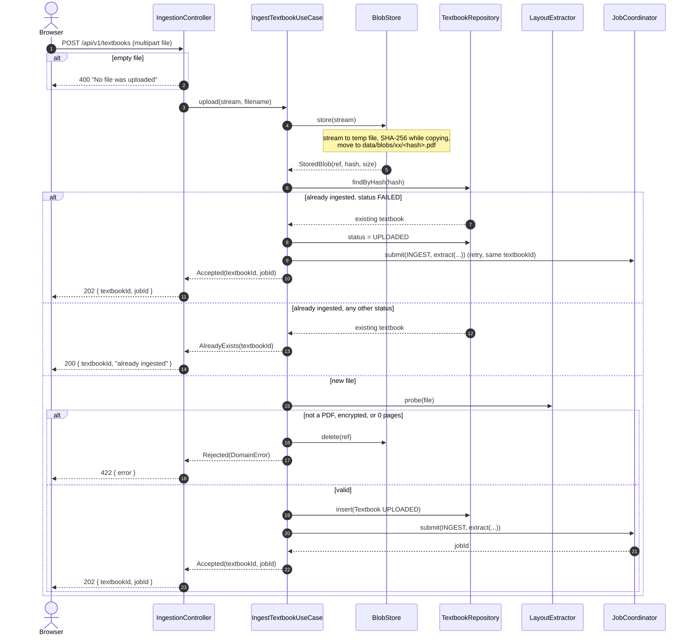
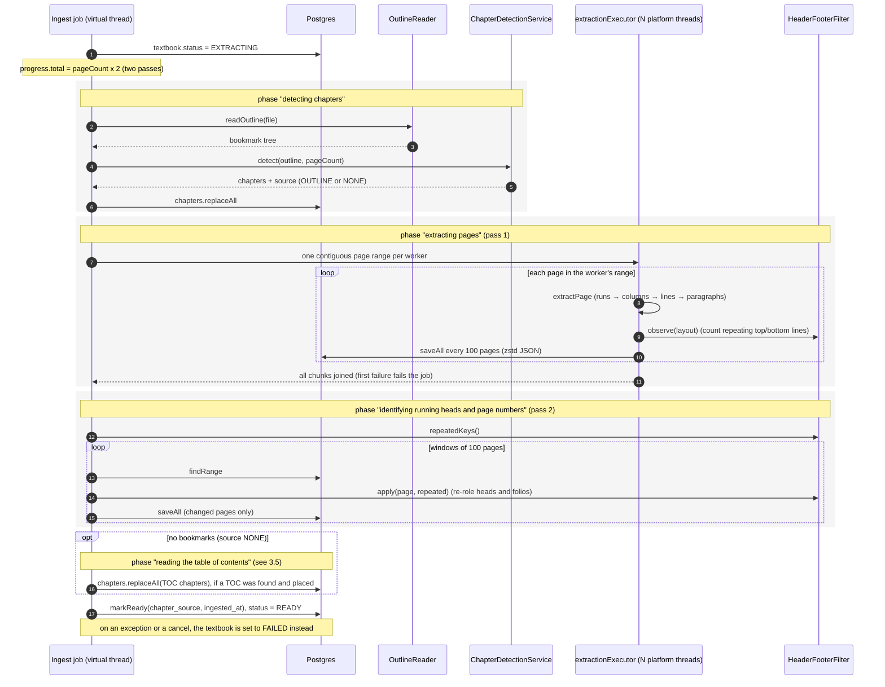
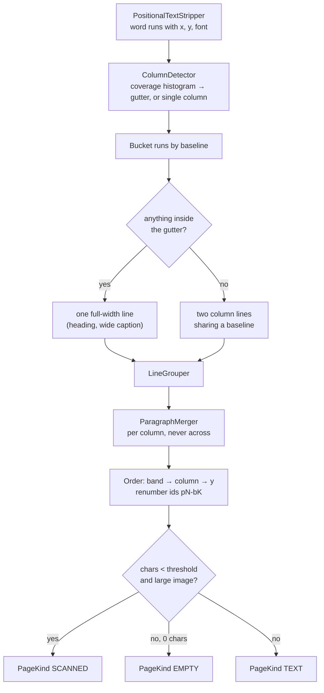
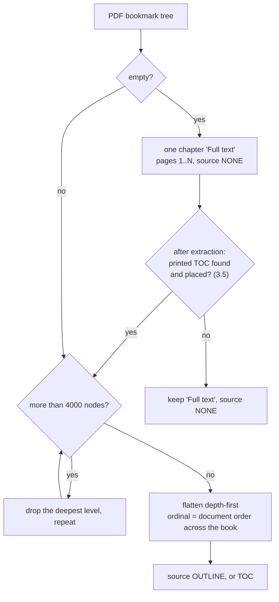
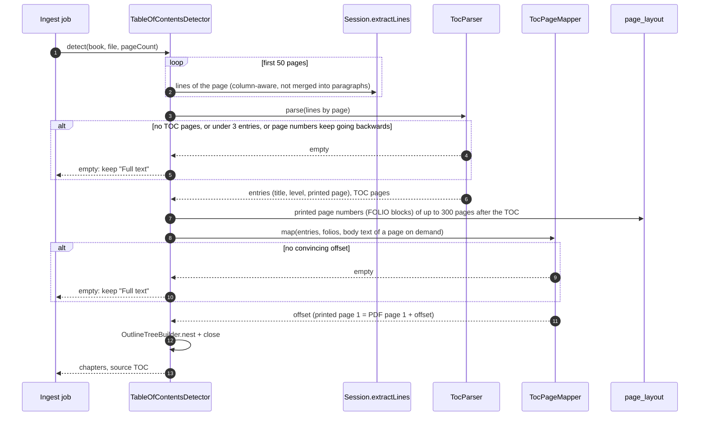

# 3. Upload and ingestion flow

**Classes:** `IngestionController`, `IngestTextbookUseCase`, `FilesystemBlobStore`, `PdfBoxLayoutExtractor`, `PdfBoxOutlineReader`, `ChapterDetectionService`, `TableOfContentsDetector`, `TocParser`, `TocPageMapper`, `OutlineTreeBuilder`, `PageSegmenter`, `HeaderFooterFilter`, `JdbcPageLayoutRepository`, `LayoutCodec`.

There are two phases. The **upload** is synchronous and returns in about a second. **Extraction** runs as an `INGEST` job.

## 3.1 Upload (synchronous)

After a `202`, the browser subscribes to `/api/v1/jobs/{jobId}/events` for progress. See [Jobs and progress](07-flow-jobs-and-progress.md).

## 3.2 Extraction (the `INGEST` job)

Cancellation is checked between pages in every extraction worker and between windows in pass 2. The check uses the job's cancel flag, so workers on `extractionExecutor` stop within a page. A failed or cancelled ingest marks the textbook `FAILED`, and uploading the same file again retries it.

## 3.3 Inside `extractPage`: from words to blocks

This order is fixed. Joining lines before columns are known merges the left column's sentence with the right column's into fluent nonsense.

- **Bands.** A full-width element splits the page horizontally. Everything above it is read first, then both columns below it.
- **Coordinates.** The y axis runs downward from the top of the page. `BlockBox.toPdfSpaceY` is the only place it is flipped for drawing.
- **One `PDDocument` per worker.** PDFBox documents are not thread-safe. Each is opened with a temp-file stream cache so a 500 MB PDF is not loaded into the heap.

## 3.4 Chapter detection

`OutlineTreeBuilder` closes each entry's page range against the start of the next entry that is not a descendant, for bookmarks and TOC entries alike. Font-size heuristic detection (`HEURISTIC`) is not implemented.

## 3.5 Chapters from a printed table of contents

Used only when the PDF has no bookmarks. It runs at the end of the ingest job, because it needs the extracted pages and the page numbers recognised by the furniture pass. Each step rejects rather than guesses: a TOC that can't be read or placed leaves the book with its single "Full text" chapter.

**Why lines are re-read.** Stored layouts merge lines into paragraphs. Dot leaders make every TOC entry full width, so no entry looks like a paragraph's short last line, and consecutive entries would be merged into one block. `PageSegmenter.segmentLines` keeps the column handling and skips the merging.

**Parsing (`TocParser`):**

| Step | Rule |
|---|---|
| TOC page | at least 4 lines ending in a page number, making up at least half the lines with letters. A "Contents" heading lowers this to 2 entries on the first page |
| Extent | consecutive TOC pages within the first 50. A "List of figures / tables / abbreviations…" heading ends it |
| Entry | `Title . . . . 12`, `Title.....12`, `Title ··· 12`, or `Title 12` |
| Wrapped title | a lettered line without a number, directly above an entry in the same column and not further left, is the first half of the title |
| Front matter | entries numbered in roman numerals (Preface … vii) are skipped |
| Level | indentation measured from the column's left edge, in 8 pt steps, at most 5 levels. A two-column TOC does not turn its right column into a deeper level |
| Order | an entry whose page goes backwards is dropped. If more than 10% do, it was not a TOC |

**Placing printed numbers (`TocPageMapper`).** Printed page 1 is rarely PDF page 1:

1. **Printed page numbers.** If at least 3 recognised folios, and 60% of them, agree on `pdfPage − printed`, that is the offset.
2. **Chapter titles.** Otherwise, candidate offsets come from where the first five titles first appear after the TOC. Each candidate is scored by how many of up to 30 sampled entries have their title in the body text of the page they map to. At least half must match. Running heads are excluded from that text, since they repeat a chapter title on all of its pages.
3. Either way, at least 90% of entries must land inside the book.

Titles are compared as lower-case letters only, without a leading "Chapter 3" or "2.1". The TOC's "3 Heart failure" then matches the page's "CHAPTER 3: HEART FAILURE".
