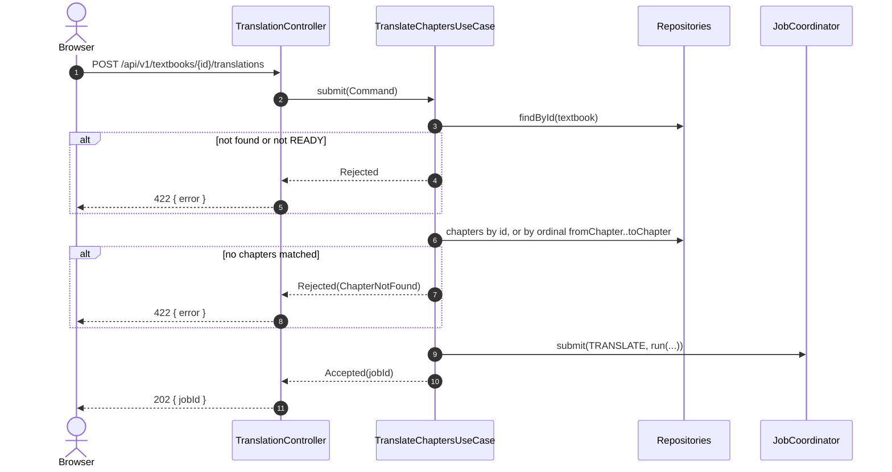
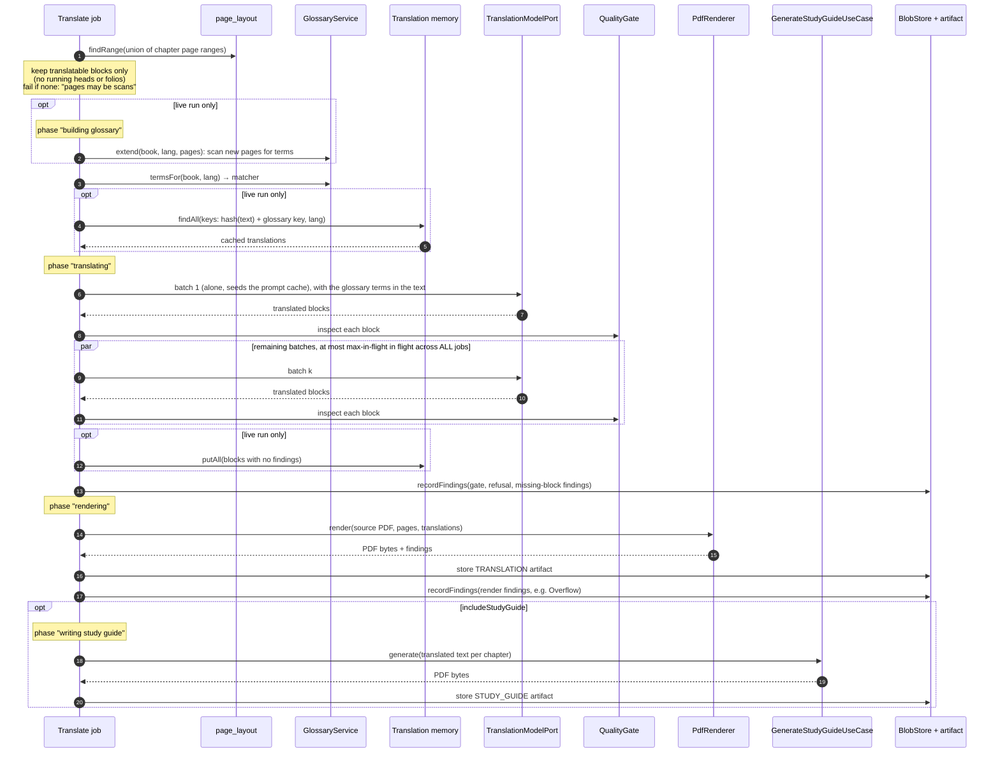
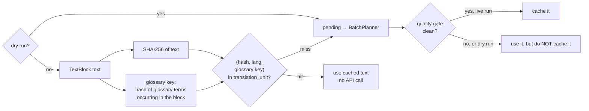
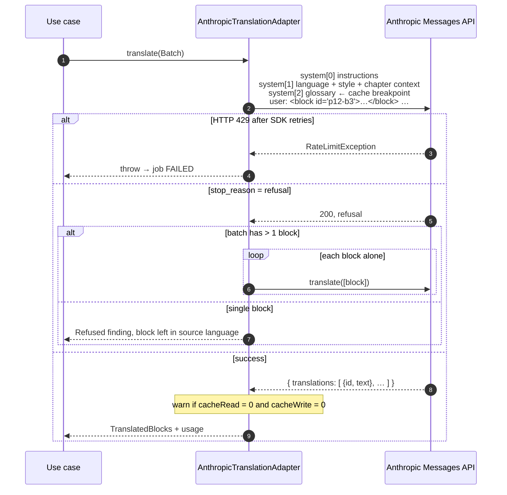
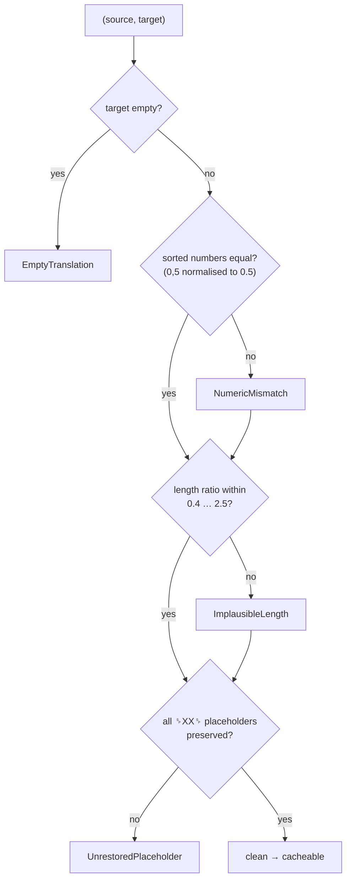
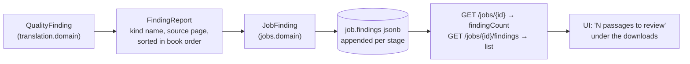

# 4. Translation flow

**Classes:** `TranslationController`, `TranslateChaptersUseCase`, `GlossaryService`, `ApiSlots`, `BatchPlanner`, `JdbcTranslationMemory`, `PromptAssembler`, `AnthropicTranslationAdapter`, `DryRunTranslationAdapter`, `TranslationQualityGate`.

A request selects chapters, either by id or by an ordinal range, and produces **one** PDF for the whole selection, plus an optional study guide. All of the work runs as a `TRANSLATE` job.

## 4.1 Request validation (synchronous)

A model is chosen when the job runs, not when the request is validated. A live request without an API key therefore returns `202`, and the job then fails with "no live translator is configured".

## 4.2 The `TRANSLATE` job end to end

**Concurrency.** Every batch, the seed batch included, holds one of `ApiSlots`: a fair semaphore of size `medlearn.translation.max-in-flight`, shared by all translation jobs in the process and by glossary extraction. The API rate limit belongs to the account, so two jobs running together share it instead of each taking 8. The slot is taken before `runBatch`, and `runBatch` checks cancellation, so a batch that waited behind other jobs makes no call once its own job is cancelled.

Progress units are **blocks**. Cache hits are counted immediately, and each batch advances the count by its size.

**Cancellation.** Each batch checks `progress.cancelled()` before calling the model, and `run` checks again before rendering and before the study guide. A cancelled job therefore stops sending batches, keeps the quality-checked translations it already paid for in translation memory, and stores no artifacts. See [Jobs, progress and cancellation](07-flow-jobs-and-progress.md#72-cancellation).

## 4.3 Translation memory

Translating the same range again live makes zero API calls. Suspect translations are never cached, because caching would make the error permanent and invisible. The glossary key makes a term edit re-translate exactly the blocks that contain the term. See [Glossary flow §11.6](11-flow-glossary.md#116-how-an-edit-reaches-the-pages-the-memory-key).

**Live runs only.** The memory key is content, language and glossary key, not the model. If dry-run output were cached, a later live run would be served the fake text. Dry runs therefore neither read nor write the memory (`useMemory = model.billable()`). A side benefit: every block in a dry run goes through expansion and fitting. Migration `V2` removed dry-run entries written before this rule existed.

## 4.4 Batching

`BatchPlanner.intoBatches` groups pending blocks in document order. Each batch stays under `medlearn.translation.max-chars-per-batch` (24 000) characters. The limit is on characters, not block count, because blocks range from a two-word heading to a 900-character paragraph.

## 4.5 One model call (live adapter)

Request settings: structured output keyed by block id, `effort LOW`, adaptive thinking, `max_tokens` 32 000, a 10-minute timeout, and a 5-minute cache TTL.

**Do not break the cache prefix.** `system[0..2]` must be byte-identical across every batch of a chapter. Never put timestamps, counters or unsorted collections in it. The glossary is always sorted by source term.

## 4.6 Quality gate

Every translated block is checked deterministically, at no cost.

Other findings are raised elsewhere. `Refused` comes from the adapter, `MissingBlock` from the use case when the model returned no entry for a block, and `Overflow` from the overlay renderer.

### Where findings go

Findings are recorded twice per job: once after translating (gate, refusal and missing-block findings) and once after rendering (overflow). On cancel, the findings gathered so far are still recorded. `jobs` stores them in its own generic `JobFinding` shape so it never depends on `translation`. The PDF is always delivered; the findings list is what a reader checks it against.

| `kind` | Raised by | Meaning |
|---|---|---|
| `NUMERIC_MISMATCH` | quality gate | numbers or units differ, e.g. a dose. The most serious finding |
| `EMPTY_TRANSLATION` | quality gate | the model returned an empty string |
| `IMPLAUSIBLE_LENGTH` | quality gate | ratio outside `length-ratio-min`…`max`, suggesting truncation or padding |
| `UNRESTORED_PLACEHOLDER` | quality gate | a protected placeholder was lost |
| `MISSING_BLOCK` | use case | the model never returned this block. It stays in the source language |
| `REFUSED` | Anthropic adapter | a safety refusal. The block stays in the source language |
| `OVERFLOW` | overlay renderer | text did not fit, so the page was reflowed |

## 4.7 Dry run

`DryRunTranslationAdapter` makes no network calls. It expands the text by about 25% and injects diacritics, so the overlay fitting ladder, the reflow fallback and font glyph coverage are all exercised at zero cost. It never touches translation memory. Use it before any live run on a new textbook.
