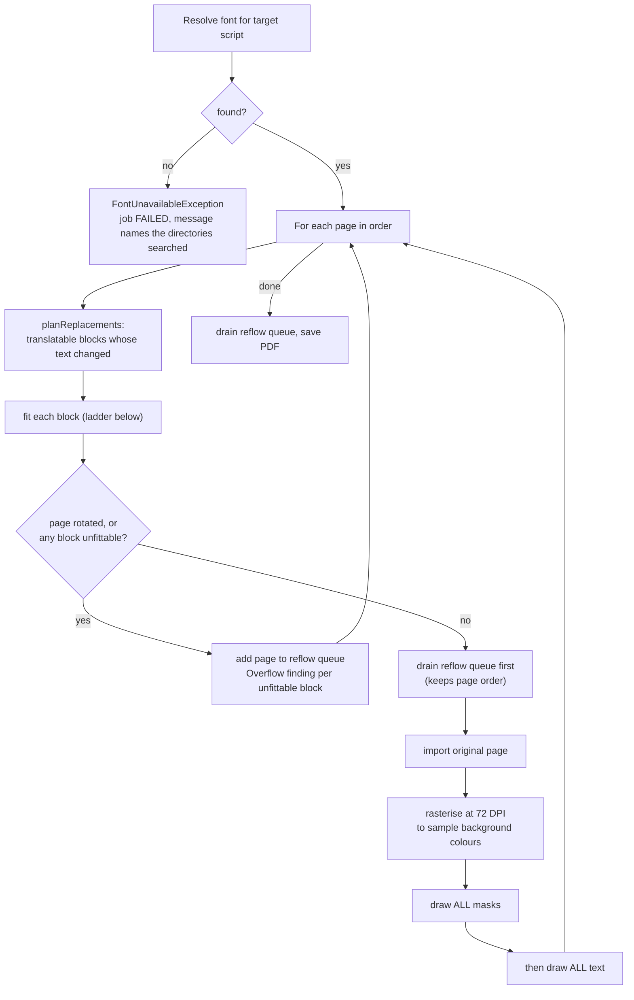
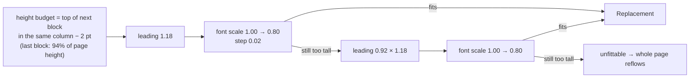
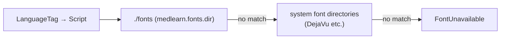

# 5. Rendering flow

**Classes:** `OverlayPdfRenderer`, `ReflowPdfRenderer`, `ScriptAwareLineBreaker`, `FilesystemFontProvider`.

`TranslateChaptersUseCase` picks the `PdfRendererPort` whose `mode()` matches the request: `OVERLAY` (the default) or `REFLOW`.

| Mode | Output | Keeps figures and tables | When to use |
|---|---|---|---|
| `OVERLAY` | the original pages with only the words replaced | yes, untouched and still vector | the default |
| `REFLOW` | a newly typeset document (HTML → PDF) with original page numbers in the margin | no | text-only reading, or when the layout is hopeless |

## 5.1 Overlay: page by page

**Masks before text, never interleaved.** A grown block can extend into the whitespace above its neighbour, so drawing mask, text, mask, text would let the next mask cover the previous block's last line.

## 5.2 The fitting ladder

- Lines are wrapped by `ScriptAwareLineBreaker`, which respects scripts without spaces between words.
- Masks are padded by 1.2 pt, plus 28% of the font size below the box so descenders are covered.
- The mask colour is sampled from just outside each block. This handles tinted panels but not gradients or photographs.

## 5.3 Reflow

`ReflowPdfRenderer` builds HTML from the translated blocks in reading order, adds CSS chosen for the script, and renders it with OpenHTMLtoPDF using the same resolved font. It is used directly for `REFLOW` requests and also as the per-page fallback inside the overlay renderer.

## 5.4 Fonts

Noto Sans and Noto Serif are bundled in `fonts/` and cover Latin, Cyrillic and Greek. For CJK, drop a Noto Sans CJK file into `fonts/`. The font is subset-embedded, so only the glyphs actually used are written.
