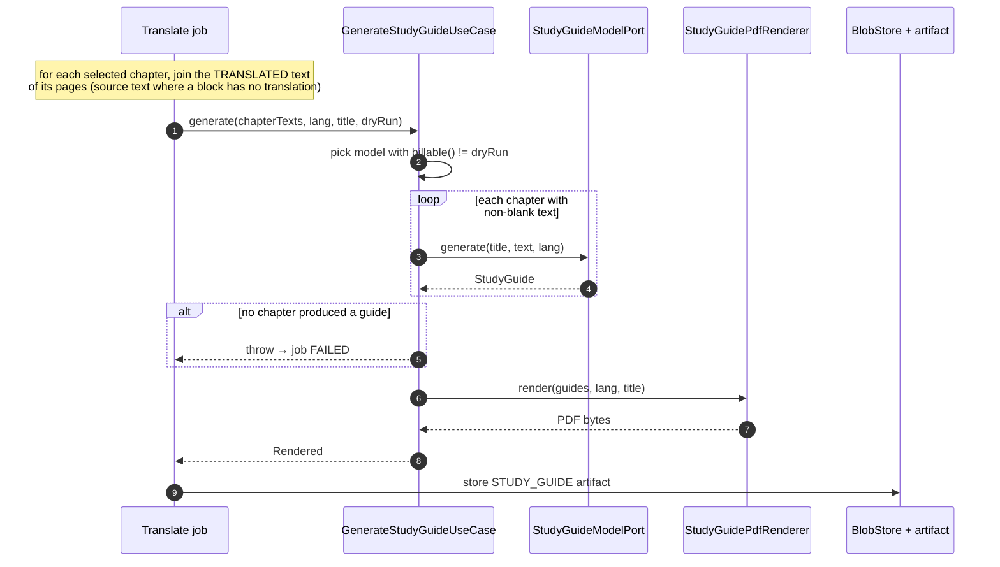

# 6. Study guide flow

**Classes:** `GenerateStudyGuideUseCase`, `AnthropicStudyGuideAdapter`, `DryRunStudyGuideAdapter`, `StudyGuideSchema`, `StudyGuidePdfRenderer`, `StudyGuide`.

There is no standalone endpoint. A study guide is produced inside a `TRANSLATE` job when the request has `includeStudyGuide: true`, after the translated PDF has been stored.

## Design points

- **Built from the translated text.** The guide uses the same terms the reader just saw, rather than inventing a second translation of each term.
- **One request per chapter.** A single request for eight chapters produces eight shallow summaries.
- **Structured output.** `StudyGuide` has objectives, key concepts, mechanisms, clinical pearls, red flags, high-yield facts and self-test items. The schema and its field descriptions, which act as prompt text, live in `StudyGuideSchema` beside the adapter. The domain record has no annotations.
- **Effort `HIGH`.** Translation uses `LOW`. Summarising is synthesis rather than transformation, and there is only one call per chapter.
- **The glossary is passed as a map** from source term to agreed rendering, covering the terms that occur in the selected chapters. The guide then names concepts exactly as the translated chapter did.
