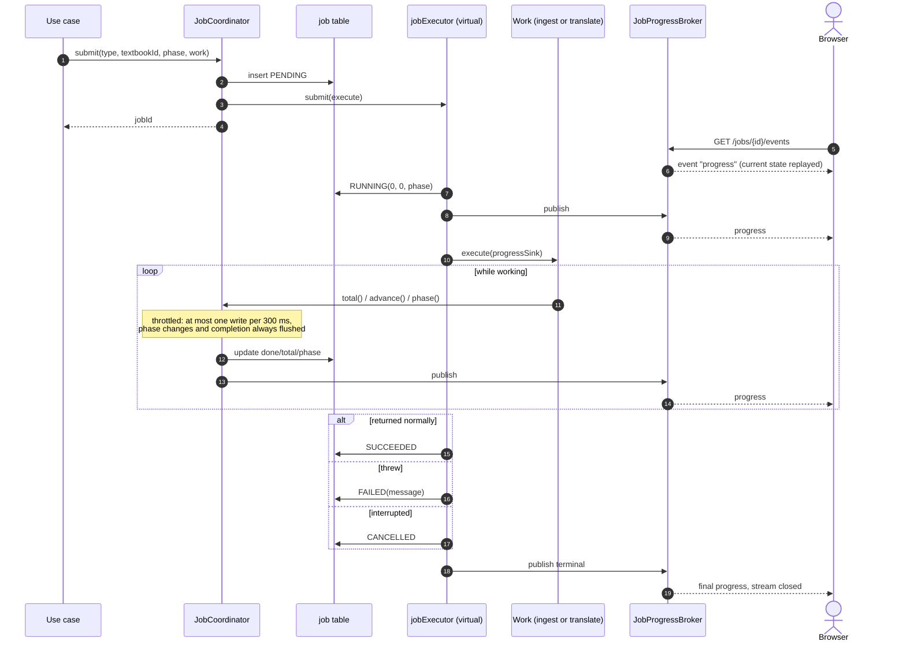
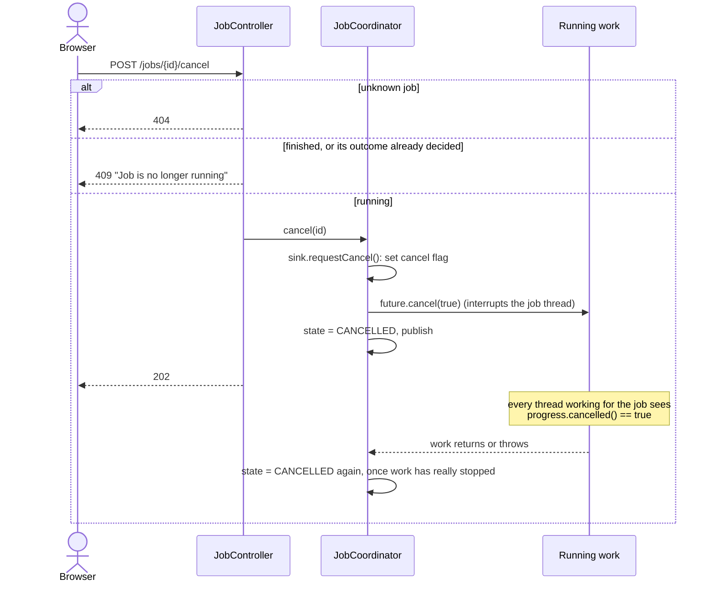
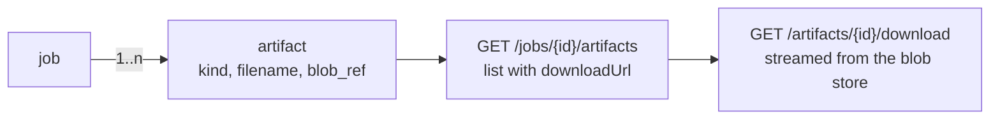

# 7. Jobs, progress and cancellation

**Classes:** `JobCoordinator`, `JobProgressBroker`, `JobController`, `ArtifactController`, `JdbcJobRepository`, `JdbcArtifactRepository`.

Any operation that takes longer than a request returns `202` with a `jobId`. The job's state lives in the `job` table and is pushed to browsers over Server-Sent Events.

## 7.1 Job lifecycle and progress



### SSE event

The event name is `progress`. The payload looks like this:

```json
{ "jobId": "…", "state": "RUNNING", "phase": "translating",
  "doneUnits": 120, "totalUnits": 480, "percent": 25, "error": null }
```

`percent` is `-1` while the total is still unknown, so the UI should show an indeterminate bar.

- A subscriber always receives the current state first. If the job has already finished, the subscriber gets one event and the stream closes.
- Emitters time out after 30 minutes. A dead client is dropped silently and never affects the job.
- The broker is **in memory**, so subscribers must be connected to the same process that runs the job. That is fine for a single local instance.

## 7.2 Cancellation



How it works (`JobCoordinator.ThrottledProgressSink`):

- **One flag per job, visible from any thread.** `progress.cancelled()` returns the job's cancel flag, or the calling thread's interrupt status. Extraction workers on `extractionExecutor` and translation batches on the per-job executor see the cancel, not just the job thread.
- **Finish and cancel are mutually exclusive.** `finish()` and `requestCancel()` are synchronized on the sink. A cancel arriving as the work completes either wins, so the job is `CANCELLED`, or is refused with `409`. A succeeded job can never be flipped to cancelled.
- **No writes after a cancel.** Progress reported by threads still winding down is dropped, so `RUNNING` is never published over `CANCELLED`. An exception thrown after a cancel, such as an aborted HTTP call, is logged at INFO and does not mark the job `FAILED`.
- **Final state written after the work stops.** The interrupt flag is cleared for that write, because borrowing a pooled connection on an interrupted thread can fail.

What each job does when cancelled:

| Job | Stops at | Keeps |
|---|---|---|
| `INGEST` | the next page in every worker, or the next pass-2 window | pages already saved. The textbook becomes `FAILED` |
| `TRANSLATE` | the next batch. Batches already sent to the API finish | translations that passed the quality gate go to translation memory, so a re-run does not pay for them again. No PDF or study guide is rendered and no artifact is stored |

## 7.3 Restart recovery

Running jobs are not resumed after a restart. Two `SmartInitializingSingleton` hooks run before the web server accepts requests, so nothing from the new process can be affected:

| Hook | Effect |
|---|---|
| `JobCoordinator.afterSingletonsInstantiated` | every `PENDING` or `RUNNING` job becomes `FAILED` with "interrupted by an application restart" |
| `IngestionRecovery` | every `UPLOADED` or `EXTRACTING` textbook becomes `FAILED`. Uploading the same file retries it |

## 7.4 Artifacts



Filenames follow `<book-slug>-<selection-slug>-<lang>.pdf`, and study guides add `-study-guide`.
