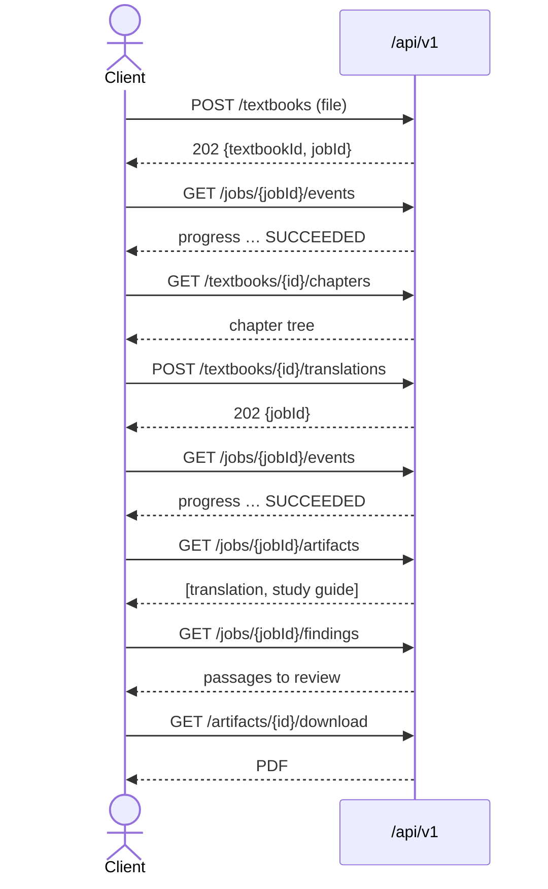

# 8. API reference

The base path is `/api/v1`. JSON is used everywhere except uploads (multipart), downloads (PDF) and progress (SSE). Errors have the shape `{ "error": "message" }`.

## Textbooks

| Method | Path | Controller | Responses |
|---|---|---|---|
| `POST` | `/textbooks` | `IngestionController` | `202 {textbookId, jobId, message}` for a new file, or a retry when the same file's textbook is `FAILED` · `200 {textbookId, message}` if the same bytes were already ingested and the textbook is not `FAILED` · `400` empty file · `422` not a PDF, encrypted, or no pages |
| `GET` | `/textbooks` | `TextbookController` | `200 [ {id, title, authors, pageCount, byteSize, status, chapterSource, uploadedAt} ]` |
| `GET` | `/textbooks/{id}` | `TextbookController` | `200` detail (adds `sourceLanguage`, `ingestedAt`) · `404` |
| `GET` | `/textbooks/{id}/chapters` | `TextbookController` | `200` nested tree `[ {id, ordinal, level, title, startPage, endPage, pageCount, children[]} ]` · `404` |
| `GET` | `/textbooks/{id}/extraction` | `IngestionController` | `200 {textbookId, extractedPages, totalCharacters, averageCharactersPerPage}` |
| `GET` | `/textbooks/{id}/debug/layout?from=1&to=3` | `IngestionController` | `200` annotated PDF, inline (at most 20 pages; `to` defaults to `from + 2`) · `404` |
| `DELETE` | `/textbooks/{id}` | `TextbookController` | `204` after removing rows, artifact files and the original · `404` · `409` a job for the textbook is still running |

## Translations

| Method | Path | Responses |
|---|---|---|
| `POST` | `/textbooks/{id}/translations` | `202 {jobId, message}` · `422` textbook not found or not `READY`, or no chapter matched |

Request body:

```json
{
  "chapterIds": ["uuid", "uuid"],
  "fromChapter": 3,
  "toChapter": 5,
  "targetLanguage": "ro",
  "renderMode": "OVERLAY",
  "includeStudyGuide": true,
  "dryRun": true
}
```

| Field | Required | Default | Meaning |
|---|---|---|---|
| `targetLanguage` | yes | — | BCP-47 style tag, e.g. `ro`, `de`, `zh` |
| `chapterIds` | one of these two | — | explicit selection |
| `fromChapter` / `toChapter` | one of these two | `0` / unbounded | inclusive range of chapter **ordinals** (document order) |
| `renderMode` | no | `OVERLAY` | `OVERLAY` or `REFLOW` |
| `includeStudyGuide` | no | `false` | also produce a `STUDY_GUIDE` artifact |
| `dryRun` | no | `false` | use the free, non-calling translator |

## Jobs and artifacts

| Method | Path | Responses |
|---|---|---|
| `GET` | `/jobs/{id}` | `200 {id, type, state, phase, doneUnits, totalUnits, percent, error, findingCount, textbookId, targetLanguage, chapterIds, options, createdAt, startedAt, finishedAt}` · `404`. For translation jobs, `options` is `{renderMode, includeStudyGuide, dryRun}` as strings. Ingest jobs have `targetLanguage: null`, `chapterIds: []` and `options: {}` |
| `GET` | `/jobs/{id}/findings` | `200 [ {kind, blockId, pageNo, message} ]` in page order · `404`. See [Translation flow](04-flow-translation.md#where-findings-go) for the kinds |
| `GET` | `/jobs/{id}/events` | `200 text/event-stream`, events named `progress` · `404` |
| `POST` | `/jobs/{id}/cancel` | `202` · `404` · `409` already finished, or finishing at that moment |
| `GET` | `/jobs/{id}/artifacts` | `200 [ {id, kind, filename, byteSize, pageCount, downloadUrl, createdAt} ]` |
| `GET` | `/artifacts/{id}/download` | `200 application/pdf` (attachment, streamed) · `404` |

## Glossary

One glossary per textbook and target language. See [Glossary flow](11-flow-glossary.md).

| Method | Path | Responses |
|---|---|---|
| `GET` | `/textbooks/{id}/glossary/{lang}` | `200 [ {id, sourceTerm, targetTerm, kind, occurrences, pinned} ]` sorted by source term · `404` unknown textbook |
| `PUT` | `/textbooks/{id}/glossary/{lang}` | body `{sourceTerm, targetTerm, kind?}`. An upsert by source term (ignoring case) that always **pins**. `200` term · `400` blank or over 80 characters · `404` |
| `DELETE` | `/textbooks/{id}/glossary/{lang}/{termId}` | `204` · `404` |

`kind` is one of `ANATOMY`, `DRUG`, `ABBREVIATION`, `CONDITION`, `OTHER`. When omitted, an existing term keeps its kind and a new one gets `OTHER`.

## Maintenance

| Method | Path | Responses |
|---|---|---|
| `GET` | `/maintenance/orphan-blobs` | `200 {deleted: false, fileCount, totalBytes, recentUnreferencedKept, files: [ {key, reason, byteSize, modifiedAt} ]}`. A preview that deletes nothing |
| `DELETE` | `/maintenance/orphan-blobs` | `200`, same shape with `deleted: true`, listing the files removed |

`reason` is `ORPHAN` (a finished file no row references) or `INCOMPLETE_WRITE` (a `.part` file left by an interrupted upload). Only files older than one hour are included. See [Configuration and operations](09-configuration-and-operations.md#96-cleaning-up-orphaned-files).

## Typical client sequence



The bundled UI (`src/main/resources/static/index.html`) follows exactly this sequence.
