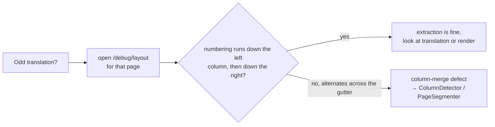
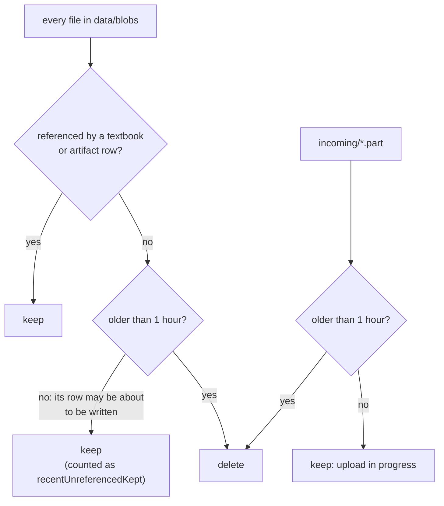

# 9. Configuration and operations

## 9.1 Running locally

```bash
docker-compose up -d     # Postgres 17 on host port 5433
mvn spring-boot:run      # http://localhost:8090
mvn test                 # full suite, no API calls
```

Spring Boot's docker-compose integration is turned off because this machine has only the standalone `docker-compose` binary. Start the database yourself.

## 9.2 Configuration keys (`application.yaml`)

| Key | Default | Env override | Purpose |
|---|---|---|---|
| `server.port` | `8090` | `SERVER_PORT` | HTTP port |
| `spring.datasource.url` | `jdbc:postgresql://localhost:5433/medlearn` | `SPRING_DATASOURCE_URL` | database |
| `spring.datasource.hikari.maximum-pool-size` | `16` | — | above the 8 extraction workers plus request threads |
| `spring.servlet.multipart.max-file-size` | `2GB` | — | upload limit. The threshold is `0`, so uploads spool to disk |
| `medlearn.blob-store.root` | `./data/blobs` | — | content-addressed file storage |
| `medlearn.ingestion.extraction-parallelism` | `0` (auto: `min(cores, 8)`) | — | size of the extraction pool, which also bounds peak memory |
| `medlearn.ingestion.page-write-batch-size` | `100` | — | page layouts per DB write, and the window size for pass 2 |
| `medlearn.fonts.dir` | `./fonts` | — | searched before the system font directories |
| `medlearn.translation.max-chars-per-batch` | `24000` | — | batch size limit for `BatchPlanner` |
| `medlearn.translation.max-in-flight` | `8` | — | concurrent translation requests across **all** jobs together (one shared limit). Lower it on `429` errors |
| `medlearn.translation.length-ratio-min` / `-max` | `0.4` / `2.5` | — | quality gate length check |
| `medlearn.anthropic.api-key` | empty | `ANTHROPIC_API_KEY` | empty means dry-run only |
| `medlearn.anthropic.model` | `claude-opus-5` | — | model for translation and study guides |

## 9.3 Debugging tools

### Layout debug PDF

`GET /api/v1/textbooks/{id}/debug/layout?from=40&to=45` draws every extracted block over the original page, numbered in reading order and coloured by column.



### Dry run

Send `"dryRun": true` on a translation request. The full pipeline runs with expanded, accented fake text and costs nothing. Use it to check overlay fitting, the reflow fallback, and font coverage on a new textbook before spending money.

### Scan check

`GET /api/v1/textbooks/{id}/extraction` reports the average number of characters per page. A real text page has thousands. An average in double digits means the pages are scans, which are not supported yet.

## 9.4 Logs worth watching

| Log line | Meaning |
|---|---|
| `No prompt cache activity on this request` (WARN) | the cached prefix changed between requests and costs are multiplying. Check `PromptAssembler` for anything that varies |
| `Table of contents on pages A-B of …: N entries, printed page 1 = PDF page P (basis)` | chapters came from the printed TOC. The basis is `printed page numbers` or `chapter titles found on their pages` |
| `Found a table of contents … but could not place its page numbers in the PDF` | a TOC was read but rejected. The book keeps "Full text" |
| `Glossary for … (lang): N term(s) added from M unscanned page(s)` | extraction result. `M = 0` means nothing needed scanning |
| `N glossary term(s) occur in the text being translated` | how many terms went into the prompt for this job |
| `Glossary extraction failed … continuing with the existing glossary` (WARN) | the pages stay unscanned and are retried next run |
| `N of M blocks served from translation memory` | how much of a live run was free. Dry runs skip the memory |
| `Batch of N refused (…); retrying block by block` | a safety refusal. Single blocks still refused are left in the source language |
| `N quality finding(s) while translating` (WARN) | gate findings. The full list is on `GET /jobs/{id}/findings` and in the UI |
| `PDF extraction pool: N platform threads` | effective extraction parallelism at startup |
| `Live translation enabled with model …` | the API key was found and live adapters are wired |
| `Marked N job(s) left unfinished by the previous run as failed` (WARN, startup) | jobs that were running when the process stopped |
| `Marked N textbook(s) whose ingestion was interrupted as failed` (WARN, startup) | upload those files again to retry |
| `Swept N orphaned file(s) and M incomplete write(s)…` (INFO) | result of `DELETE /maintenance/orphan-blobs` |
| `Job … stopped after cancellation: …` (INFO) | an exception thrown while a cancelled job was winding down. This is expected and is not a failure |

## 9.5 Fonts

The bundled fonts are `NotoSans-Regular`, `NotoSans-Bold` and `NotoSerif-Regular`, covering Latin, Cyrillic and Greek. DejaVu is found on the system as a fallback. For Chinese, Japanese or Korean, put `NotoSansCJK-Regular.otf` (or similar) in `fonts/`. Without it, rendering fails with a message naming the directories searched.

## 9.6 Cleaning up orphaned files

An orphan is a file in `data/blobs` that no `textbook` or `artifact` row points at. Deletes now remove their files, so orphans only come from deletes made before that fix, or from a crash between writing a file and inserting its row.

```bash
curl http://localhost:8090/api/v1/maintenance/orphan-blobs              # preview, deletes nothing
curl -X DELETE http://localhost:8090/api/v1/maintenance/orphan-blobs    # delete what the preview listed
```



- **Run on request, not automatically.** If `SPRING_DATASOURCE_URL` points at a different database while `data/blobs` stays the same, every file looks orphaned. Always check the preview first.
- **Safety refusal.** If no `BlobReferencesPort` implementation is wired in, the sweep refuses to run rather than treat every file as an orphan.

## 9.7 Native access

zstd-jni loads a native library, so the JVM needs `--enable-native-access=ALL-UNNAMED`. The flag is set for `spring-boot:run` and for surefire in `pom.xml`. Add it to any other way you launch the app, such as a Dockerfile or an IDE run configuration.
