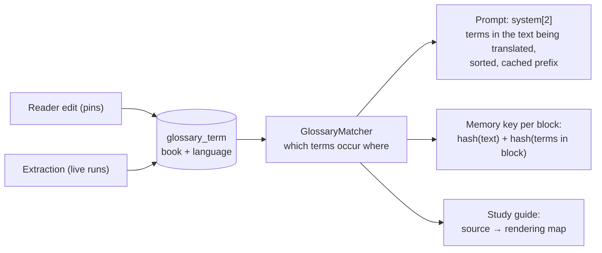
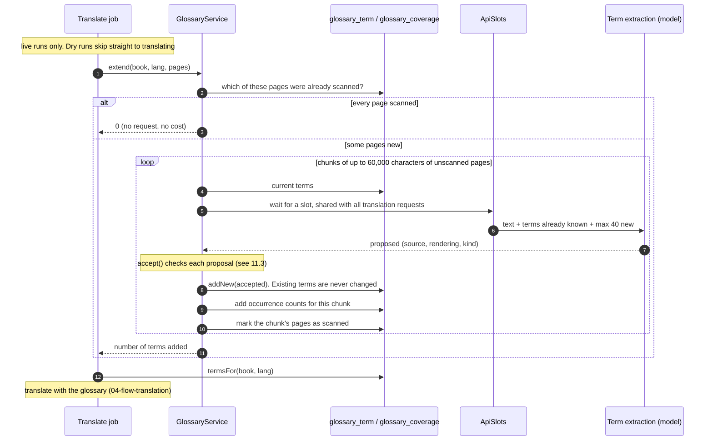
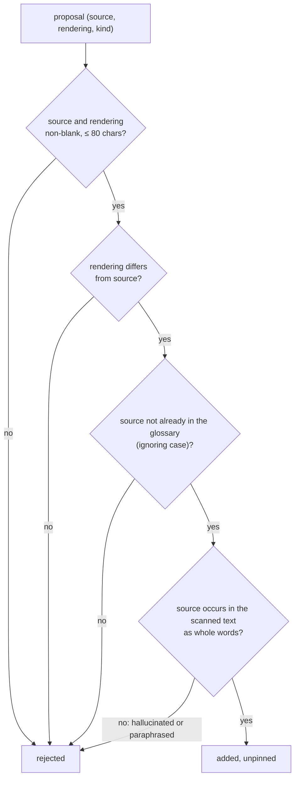
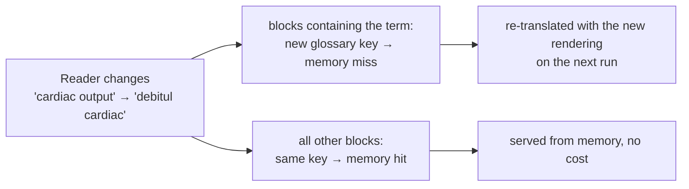
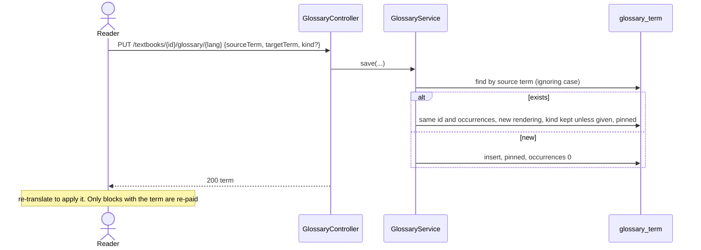

# 11. Glossary flow

**Classes:** `GlossaryService`, `GlossaryMatcher`, `GlossaryTerm`, `JdbcGlossaryRepository`, `AnthropicTermExtractionAdapter`, `GlossaryController`, `ApiSlots`. The memory side is `TranslationMemoryPort.Key`.

A glossary keeps a medical term's translation identical across the whole book: "heart failure" must not become one phrase on page 40 and another on page 940. There is one glossary per textbook **per target language**. Terms get in two ways:

- **Extraction.** A live translation scans pages it hasn't scanned before and asks the model which terms need a fixed rendering.
- **Reader edits.** Adding or correcting a term in the UI or API **pins** it.

## 11.1 Where the glossary is used

## 11.2 Building the glossary during a live translation

- **Each page is scanned once per language.** Re-translating a range, or any range overlapping one already scanned, costs no extraction.
- **Failures are not fatal.** If a request fails or is refused, extraction stops, the remaining pages stay unscanned (so the next run retries them), and translation continues with the glossary it has.
- **Cancellation** is checked before each chunk and again after waiting for a slot.
- **Dry runs never extract.** Their output is fake, and a fake rendering stored in the glossary would be served to every later live run, the same failure the translation memory once had.

## 11.3 What a proposal must pass

## 11.4 Stability rules

| Rule | Why |
|---|---|
| Extraction only **adds** terms. A term already present keeps its rendering, pinned or not | pages may already use it, and consistency is the point |
| Only a reader's edit changes a rendering, and the edit pins the term | a human decision is never overwritten by a model |
| Source terms are unique per book and language, **ignoring case** (`glossary_term_unique_source`) | "Heart failure" and "heart failure" must not get two renderings |
| Deleting a term is allowed | a later extraction may propose it again for pages not yet scanned |

## 11.5 Matching (`GlossaryMatcher`)

- **Whole words only.** "ventricle" does not match "ventricles", and "MI" does not match inside "MIDDLE".
- **Case-insensitive,** except `ABBREVIATION` terms, which must match exactly. "MI" is myocardial infarction; "mi" is not.
- **The longest term wins.** In "left ventricle failure", "left ventricle" matches and "ventricle" does not match separately.
- **Base forms only.** A plural or inflected form in the source text does not match. See [Known gaps](10-known-gaps.md).

## 11.6 How an edit reaches the pages: the memory key

The translation memory key per block is `(SHA-256 of the text, target language, glossary key)`. The **glossary key** is `GlossaryMatcher.fingerprint` of the terms occurring in that block: a SHA-256 over their lower-cased source and rendering, independent of order and kind.

- A block with no glossary terms has the key of the empty string, `e3b0c442…b855`. Migration `V3` gave all earlier memory rows that key, because they were translated without a glossary.
- The memory is shared across books, and the key holds the actual terms, so two books with the same terms in a passage share the cached translation.

## 11.7 In the prompt

The terms that occur in the blocks being translated are computed **once per job**, sorted by source term, and sent as `system[2]`, the last block of the cached prefix. Computing them per batch would change the prefix bytes between batches and defeat prompt caching. See [Translation flow §4.5](04-flow-translation.md#45-one-model-call-live-adapter).

## 11.8 Reader edits (API and UI)

The UI's glossary card (section 5) follows the language selected for translation. Each rendering is editable and saved on change, which pins it, and the card refreshes after every translation so newly extracted terms appear.

## 11.9 Cost

| | Requests |
|---|---|
| First live translation of N pages | about `N × page chars ÷ 60,000` extraction requests (≈1 per 20 pages), plus translation |
| Re-translating the same pages | 0 extraction requests |
| After an edit | 0 extraction requests, and only blocks containing the term are re-translated |
| Dry run | 0 |
