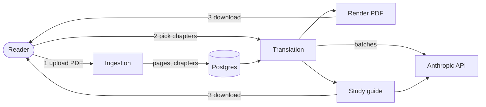

# Technical documentation

Technical documentation for the medical textbook translation service. The root `README.md` explains how to run it. These pages describe how it works.

All diagrams are [Mermaid](https://mermaid.js.org/). They render on GitHub and in the IntelliJ Markdown preview. If a diagram shows up as raw text, enable Mermaid under *Settings → Languages & Frameworks → Markdown*.

## Contents

| # | Document | Read it when you want to know… |
|---|---|---|
| 1 | [Architecture (HLD)](01-architecture-hld.md) | what the system is made of, how the contexts depend on each other, and what threads run what |
| 2 | [Data model](02-data-model.md) | which tables exist, what the states of a textbook and a job are, and how files are stored |
| 3 | [Upload and ingestion flow](03-flow-upload-and-ingestion.md) | what happens from the moment a PDF is uploaded until its chapters can be picked |
| 4 | [Translation flow](04-flow-translation.md) | how chapters are batched, cached, sent to the model, and checked |
| 5 | [Rendering flow](05-flow-rendering.md) | how the translated PDF is drawn, in overlay and reflow mode |
| 6 | [Study guide flow](06-flow-study-guide.md) | how the study guide is produced from the translated text |
| 7 | [Jobs, progress and cancellation](07-flow-jobs-and-progress.md) | how long-running work is tracked, streamed to the browser, and cancelled |
| 8 | [API reference](08-api-reference.md) | every endpoint, its request, and every status code it can return |
| 9 | [Configuration and operations](09-configuration-and-operations.md) | the settings, the two debugging tools, fonts, and cleaning up orphaned files |
| 10 | [Known gaps](10-known-gaps.md) | what is not built, or does not yet behave as the design intends |
| 11 | [Glossary flow](11-flow-glossary.md) | how terms are extracted, matched, edited, and kept consistent across the book |

## The whole system in one picture

## Keeping these docs current

Any change to behaviour, an endpoint, a table, a configuration key, or the package structure must update the affected pages in the same change, as well as `CLAUDE.md` at the repository root. Each flow page names the classes it describes. When you rename or move one of those classes, search `docs/` for the old name.
